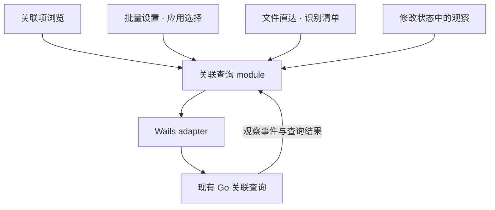

# 统一前端关联查询

状态：2026-11-13，Q1–Q4 与完整方案已由用户确认；共享 module 和三个入口已接入，自动测试、构建与浏览器补验通过。

关联项浏览、批量设置的应用选择与文件直达共用一个关联查询 module，集中查询复用、观察归并及订阅生命周期。目标是让三个调用方通过同一 interface 获得观察和刷新状态，减少重复的并发与过期响应处理。

## 已确认的行为

| 决策 | 用户选择 |
| --- | --- |
| Q1 面板重开 | 先显示上次观察并标注正在刷新，同时立即重新查询。 |
| Q2 候选顺序 | 首次按候选覆盖数量排序后，本次打开期间更新覆盖数量，保持已有应用的相对顺序。 |
| Q3 刷新失败 | 保留上次观察，明确标注刷新失败及旧观察；仍可选择应用，批次预览重新查询并判断可执行项。 |

这些规则适用于识别清单与应用选择面板。关联项浏览继续支持后台预取、选中项查询、手动刷新及窗口激活刷新。

## Module 与 interface

一个应用窗口中的三个调用方共享关联查询 module；缓存只存在于本次前端运行的内存中。生产使用 Wails adapter，测试使用可控制响应先后和事件的 adapter；这两个 adapter 使内部 seam 有实际用途。

界面的 interface 包含三种意图：

- 观察一组关联项，获得每项默认应用、系统候选应用、刷新状态与查询错误。
- 请求刷新指定关联项；用户明确刷新时必须发起新查询。
- 停止观察，释放该调用方的订阅及尚未开始且无人需要的查询。

浏览预取、面板打开及用户刷新具有明确的内部调度规则，调用方不传请求 token、并发数、版本比较函数或完成回调有效性判断。由 React 绑定管理订阅创建和清理。

单条观察事件和修改状态快照中的观察统一进入 module；快照接入属于应用装配，不要求每个界面处理。通知文案、搜索、候选覆盖计算和列表排序继续属于相应界面的 implementation。

## Implementation 约束

1. **共享进行中查询。** 按关联种类与具体身份复用普通查询。打开面板时已有相同查询正在进行，可以加入该查询；已有缓存但没有进行中查询时立即重新查询。手动刷新始终发起新查询，并阻止旧结果覆盖新观察。
2. **集中调度。** 三处各自的后台 worker 合并为一个调度点；后台并发沿用 4 个预算，当前选中项及明确刷新优先处理。已失效的旧查询不能让新刷新等待它结束。
3. **分别解释默认与候选。** 两类查询可能独立成功或失败。旧观察可展示，但要保留错误、已过期及未知含义；不能把候选查询失败当作零覆盖，也不能把旧候选统计说成本次查询已确认的覆盖。
4. **版本与请求时序。** 观察按 Go 返回的版本单调归并；忽略 superseded 结果；没有服务端版本的连接错误必须同时受请求身份与已接收观察约束。迟到快照、成功或错误都不能覆盖较新事实。
5. **订阅彼此独立。** 关闭一个面板只释放它自己的需求。其他界面仍使用同一查询时继续接收结果。已经发出的查询可以完成并更新共享观察，但不能重新打开已关闭面板或改变其加载状态。
6. **生命周期。** 应用卸载时移除事件订阅、计时器和待启动任务；旧生命周期的响应不能写入新实例。React StrictMode 的清理与重新建立需覆盖测试。
7. **刷新后同步。** 新观察更新所有仍在观察该关联项的界面。批次预览记录继续表示那次预览，不由显示侧的观察更新直接改写。

## 候选列表的具体呈现

以下细节已随 Q4 的完整方案确认，用于落实 Q1–Q3：

- 有足够的旧候选观察时，面板打开即可据此建立初始顺序；后续刷新只更新覆盖及错误提示。
- 没有旧候选观察时，先显示已发现的应用和查询中提示；首轮候选查询结束后按覆盖数量排序一次，此后保持已有应用的相对顺序。
- 后续查询新发现的应用副本追加到列表末尾。搜索只过滤列表；关闭重开时重新按当时观察排序。
- 有效的新观察显示某应用已不属于系统候选时，更新其覆盖数量。应用副本仍可作为用户选择；实际可用性由现有预览检查。
- 刷新失败时显示“上次查询覆盖”等明确措辞；没有任何有效旧观察的项继续显示未知。

## 与修改请求的关系

Go 中这些读取仍直接查询系统：

- `PrepareBatch` 为每项生成批次预览。
- `submit` 在提出修改请求前再次查询并比较用户看到的默认应用。
- `change.Query` 只有在系统完成之后开始的可信查询才能结束对应请求的回读。

前端共享观察不替代这些读取。已有单项修改对可信观察的要求继续成立；选择应用本身不表示可以执行修改。相关依据为 `internal/change/batch.go`、`internal/change/service.go` 和 `TestSupersededReadbackCannotSettleFromPreCompletionCache`。

关联查询、系统候选应用和回读沿用 [GLOSSARY.md](../GLOSSARY.md) 的含义；本方案没有新增领域术语。ADR-0001 与 ADR-0002 的决策继续适用。

## 测试与改动范围

共享状态与调度位于 [`associationQueries.ts`](../frontend/src/associationQueries.ts)，React 绑定和生产 adapter 位于 [`QueryObservations.tsx`](../frontend/src/QueryObservations.tsx)。`App.tsx` 为每个窗口创建一个共享实例。现有 `useAssociationQueries.ts` 保留浏览特有的刷新触发规则；`Batch.tsx` 与 `FileDrop.tsx` 移除各自的 worker 与查询结果状态。

测试通过调用方使用的 interface 控制场景；内部 seam 注入查询与事件 adapter，不直接断言私有队列或 reducer 的结构。

| 场景 | 需验证的结果 |
| --- | --- |
| 浏览与面板同时请求同一关联项 | 普通进行中查询只发起一次，两处都获得结果。 |
| 关闭其中一个面板 | 另一调用方仍获得结果；已关闭面板不恢复活动。 |
| 明确刷新与旧查询重叠 | 新查询立即发起；旧成功、旧错误及 superseded 结果不能回退观察。 |
| 面板重开与刷新失败 | 旧观察先显示，刷新状态明确；失败保留旧观察并标明。 |
| 默认与候选部分失败 | 两类结果分别呈现；失败项不是零覆盖。 |
| 候选覆盖变化及新副本出现 | 初次排序后的已有项不跳动，新副本追加，重开后重新排序。 |
| 新事件先于旧快照或连接错误 | 保留较新观察；错误不会覆盖新事实。 |
| 切换目录、卸载与 StrictMode | 无重复订阅，过时后台需求不再启动，旧实例响应不污染新实例。 |
| 单条观察更新 | 保留现有真实表格只重渲染对应默认应用单元格的保证。 |

保留现有浏览、批次、文件直达和性能交互测试；新增共享 module 的 interface 测试验证跨调用方调度、独立清理、故障和生命周期，hook 测试继续覆盖浏览触发与快照接入。既有“丢弃旧浏览选择的结果”断言已调整：结果可进入共享观察，当前选中项的加载状态保持独立。

架构审阅基线：8 个 Go 包通过；前端全量首次 140/141 通过，`App.browser.test.tsx:280` 的数量文本断言失败，单例复跑通过，原因尚未确定。

实施验证：

- `npm --prefix frontend test`：15 个测试文件、153 项测试通过，包含原数量断言。
- `npm --prefix frontend run build`：TypeScript 与正式前端构建通过。
- `npx astryx doctor --built dist`：0 失败；外部主题字体的自动证明仍有提示。
- 真实浏览器运行产品前端与临时查询 adapter：验证覆盖变化时顺序稳定、关闭重开后重新排序、候选与识别清单在刷新失败时显示旧观察、弹窗没有横向溢出。
- 浏览器补验使用样例查询和识别数据；未执行真实 macOS 默认应用修改。Go 的预览、预检、回读与持久化 implementation 未改动。

## Depth 的验收

locality：查询复用、版本归并及释放订阅的知识只在一个 module 内维护。

leverage：同一 implementation 和同一组时序测试支持三个实际调用方。

deletion test：删除共享 module 后，上述规则需要重新分布到三个界面，说明它提供 depth；只搬移 worker 函数而让调用方继续管理时序，会形成 shallow module，不满足本方案。
