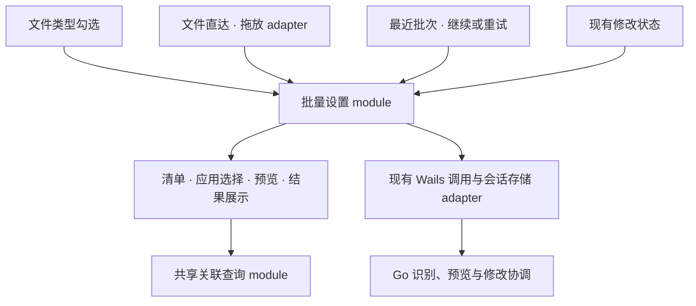

# 统一批量设置的前端流程

状态：2026-11-13，候选 02；Q1 与完整设计均已由用户确认，implementation、自动测试、正式前端构建与浏览器补验已完成。

基线为 `3dfed0b`。候选 01 已集中关联查询；本候选集中批量设置的临时清单、阶段转移、准入及异步响应归属，让勾选、文件直达和继续最近一批使用同一 module。

## 已继承的决策

以下行为已经在[批量设置规格](batch-file-associations.md)、[文件直达规格](file-drop-associations.md)及 [ADR-0002](adr/0002-explicit-batch-resume.md)中确认，直接继承。

- 文件类型页勾选跨搜索、筛选及浏览入口保留；全选只作用于当前筛选结果。关闭尚未提交的批量流程保留勾选。
- 文件直达按实际类型归并；拖入清单与已有勾选独立，选择应用及提交拖入清单均不清空无关勾选。取消丢弃临时文件清单，明确保存的手动关联保留。
- 识别清单空闲时允许追加、明确选型、移除与恢复；识别期间、选择应用、预览、其他弹窗或已有修改阻塞时拒收新拖入，说明原因，不排队。
- 返回识别清单保留本次文件、类型选择及排除项，后续重新选择应用生成新的批次预览；旧预览不能随清单修改而变化。
- 只有明确开始才提交；丢失提交应答时核对原提交身份。结果未定不代表失败，关闭界面不代表撤回系统请求。
- 继续未执行项、重新处理问题项均重新预览并明确确认；更换目标按现有 Go 规则创建新批次，只处理确认的待处理项。取消不会修改已保存的最近批次。
- Go 继续持有已开始批次、执行、恢复及持久化事实；前端展示版本化快照。关联查询继续使用候选 01 的共享 module，预览、预检和回读仍由 Go 独立执行。

## 本次新增决策

| 问题 | 用户选择 |
| --- | --- |
| Q1 准备预览时退出 | 允许在“检查当前默认并准备预览”期间关闭面板，或从文件直达返回识别清单；忽略随后到达的旧预览。点击开始后的提交核对沿用现有规则。 |

Q1 允许放弃前端对这次预览的需求，不要求底层系统查询已经取消。返回后可以调整并发起新的预览；旧响应及其结束回调不能覆盖新预览、显示旧错误或清除新操作的忙碌状态。

## 当前摩擦及证据

| 位置 | 调用方承担的规则 |
| --- | --- |
| `frontend/src/Batch.tsx`：`useBatchSettings` | 分别维护 `modal`、`workflow`、`preview`、`working`、`pending`，并通过 controller 暴露 setter 及完整 `changes`。 |
| `frontend/src/Batch.tsx`：`BatchBars`、`BatchDialogs`、`PreviewDialog` | 展示代码直接改变阶段、错误和勾选，自己组合开始、返回及继续的禁用条件。 |
| `frontend/src/FileDrop.tsx`：`draftOpen` 与清理 effect | 通过 `modal` 与 `workflow.source` 推断临时清单是否还属于当前流程。 |
| `frontend/src/FileDrop.tsx`：`blockedReason` 与拖入回调 | 同时读取修改状态、批量状态、局部活动和 DOM 弹窗，自行决定准入并直接打开批量面板。 |
| `frontend/src/Batch.tsx`：`BatchAppPicker.pick` | 原生应用选择的返回直接调用旧 `onSelect`；缺少流程身份校验，无法保证退出后的回调不会再次准备预览。 |
| `frontend/src/Batch.tsx`：`start` 与 `reconcile` | 自动核对等待开始调用结束；即使修改快照已包含原预览身份，只要开始应答未返回，仍可能保持受理中。现有丢应答测试只覆盖 Promise 拒绝后的核对。 |
| `frontend/src/App.tsx`：`canChange`、`submitBlocked` | 单项入口需要知道批量操作中哪些内部状态会阻塞新的修改。 |

这些是源码与测试审阅结论；原生选择器期间退出的具体桌面时序尚未实机复现。

## Module、interface 与 seam

批量设置 module 拥有一个窗口内的未提交勾选、文件识别清单及当前前端流程。它接收最新修改状态，输出只读展示状态和可用动作。界面表达用户意图，不自行拼装内部状态组合。

interface 围绕实际动作组织：

- **勾选**：切换一项、切换当前筛选结果、移除与清空、查看已选、用勾选清单选择应用。
- **文件直达**：接收拖入、明确文件类型、移除或恢复类型、明确保存手动关联、用当前识别清单选择应用。
- **流程导航**：选择应用副本、打开原生应用选择器、更换应用、返回识别清单、关闭、查看最近批次。
- **提交与恢复**：携带明确确认开始、停止后续设置、继续或重试、核对原提交、查询未定项。

只读状态包含当前阶段及其内容、错误与活动提示、勾选集合、最近批次展示和动作可用性。调用方不接收 raw setter、流程版本、请求令牌、可变集合或完整 `Changes` controller；对旧未定请求的风险确认、替换旧批次的确认作为开始动作的输入。旧请求的确认绑定其具体身份，预览期间出现另一个恢复请求时须重新确认。

interface 中的动作自行检查当前阶段与准入，按钮禁用仅用于呈现。单项修改入口消费批量 module 提供的阻塞状态，继续叠加其已有修改约束。

外部 seam 位于用户动作与只读展示状态之间。内部 seam 注入识别、应用选择、预览、开始、停止、核对、快照接入及会话存储。生产使用现有 Wails 与浏览器 adapter，测试使用可控制响应顺序及存储失败的 adapter；两个实际 adapter 支持该 seam。

DOM 拖放 adapter 保留 Wails 事件、窗口拖放属性、阻止浏览器导航及“其他弹窗是否打开”的环境检测。它只提供路径及环境事实；业务准入、清单更新和拒收原因由批量 module 决定。

## 状态与响应归属

1. 当前阶段只包含该阶段需要的内容，避免“预览面板已开但预览为空”等组合。识别、选择原生应用、准备预览、提交、核对和停止分别记录活动身份，替代通用 `working` 的跨流程约定。
2. 勾选集合独立于活动流程；文件清单随文件直达流程创建和结束，不能再由展示代码的 effect 推断其寿命。
3. 每次准备预览捕获清单、目标及恢复来源。返回、关闭或进入新流程使旧预览失效；已展示的预览是不可变的那次检查结果。
4. 识别、应用选择、可选保存及准备预览的返回检查所属生命周期、流程和活动。旧成功、旧错误和旧结束回调都不能操作新的流程。
5. 关闭不会撤销已明确发起的手动关联保存或原生应用选择所产生的现有保存行为。过时响应只失去更新已关闭流程的资格。`PickApplication` 会保存选中的应用副本信息，不能把它描述成纯读取。
6. 开始前保存原预览身份，之后以同一身份受理或核对；先保存失败则不调用开始。已提交或正在核对的操作不能因为 Q1 的取消能力被遗忘，也不能换新身份重发。
7. 接收 `accepted` / `existing`，或最新可信快照的批次 `commands` 包含原预览身份时，按捕获的流程来源一次性清理本次临时状态并显示结果；开始 Promise 尚未结束也不能阻止使用已确认的受理事实。随后到达的旧应答不能再清理勾选或切换新的流程。其他结果继承现有重新预览或查看最近批次的路径，Go 快照继续经已有版本校验接入。
8. 核对使用现有 `ReconcileBatchStart`：它返回找到原操作或已关闭原提交身份，不创建新的修改。核对通信失败继续保留原身份及重试入口，不推断请求未受理。
9. 卸载释放订阅和环境挂载；旧生命周期响应失效。连接与清理必须支持 React StrictMode 的重复建立，不能永久销毁仍会再次连接的实例。前端重载遇到会话中保存的提交身份只核对原操作；旧生命周期不能产生重复开始或重开面板。

## 改动安排

- 新增 `frontend/src/batchWorkflow.ts`，集中流程状态、动作、准入、清单隔离和响应归属。
- 新增 `frontend/src/useBatchSettings.ts`，装配生产 adapter、现有修改状态和 React 订阅。Wails 与会话存储适配留在这里，不为每项操作建立转发文件。
- `Batch.tsx` 保留批量清单、候选应用、预览及结果展示；移除流程 implementation 和直接 setter。
- `FileDrop.tsx` 保留拖放环境接入与识别清单展示；移除清单寿命、业务准入和异步流程状态的重复管理。
- `App.tsx` 装配新绑定，消费明确的选择动作及阻塞状态。
- 查询 module 与 Go 执行流程沿用现有 interface；不引入通用状态机框架或第二套批次执行队列。

## 验证与 depth

测试通过调用方使用的 interface 操作 module，观察状态及 adapter 调用结果；不依赖内部 reducer、令牌或队列形状。

| 场景 | 验收结果 |
| --- | --- |
| 识别中取消，马上拖入新文件，旧识别最后完成 | 只展示新清单，旧响应不清除新忙碌状态。 |
| 准备预览时关闭或返回；随后开始新的预览 | 退出立即生效；旧成功、失败和结束回调都不能影响新流程。 |
| 原生应用选择的响应在来源流程结束后到达 | 不重新打开预览、不污染新错误，明确保存的现有行为不被撤销。 |
| 返回清单追加、移除、恢复或重新选型 | 保留有效选择，重新预览使用新的清单，旧预览保持原义。 |
| 有勾选时完成、取消或核对文件直达批次 | 不清空无关勾选；只有来自勾选的已受理批次清理其勾选。 |
| 识别、应用选择、预览、其他弹窗、修改未定或退出期间拖入 | 拒收并给原因，之后不会自动处理被拒绝的文件。 |
| 开始身份保存失败、重复开始、提交丢应答、重载 | 保存失败不提交；开始不会重复；核对始终使用原身份。 |
| 开始应答悬而未决，可信修改事件先确认相同预览身份 | 按原来源一次性完成受理后的清理；旧开始应答不能改变后来打开的流程，无第二次提交。 |
| 继续剩余项、重试问题项、更换目标后取消 | 只预览确认的待处理项；旧批次保留；没有自动执行。 |
| 新修改快照与旧操作应答交错 | 快照不回退；操作状态与响应身份一致，显示正确的可用动作。 |
| 卸载、重新建立和 StrictMode | 环境清理完整，旧响应不能影响新生命周期，无重复提交。 |

保留现有 `App.batch.test.tsx`、`App.file-drop.test.tsx` 和查询、浏览、性能集成测试；新增 module interface 测试覆盖上述时序，UI 补充 Q1 和导航接线测试。现有测试按用户行为组织，无需为搬移代码批量删除。

## 实施验证

- [`batchWorkflow.test.tsx`](../frontend/src/batchWorkflow.test.tsx)：29 项 interface 测试，覆盖三种入口、响应交错、准入、保存失败、恢复确认身份、显式继续及生命周期重接。
- [`App.batch.test.tsx`](../frontend/src/App.batch.test.tsx)与 [`App.file-drop.test.tsx`](../frontend/src/App.file-drop.test.tsx)：保留既有 18 项，新增 5 项产品交互测试，包括 StrictMode 重接、准备预览时关闭与返回、应用选择迟到及受理事件先到。
- `npm --prefix frontend test`：16 个文件、187 项测试通过；包括关联查询、真实表格局部重渲染和浏览行为的既有测试。
- `npm --prefix frontend run build`：TypeScript 与正式前端构建通过。
- 在 `frontend` 中运行 `npx astryx doctor --built dist`：20 项通过、0 失败；两项既有外部主题字体校验提示仍在。
- 使用真实浏览器加载产品入口与临时 Wails adapter：准备预览时关闭后勾选保留；旧预览和应用选择返回不会重开面板；准备期间返回识别清单后能追加文件且旧错误不污染清单；受理事件先到时显示结果、清除待核对身份并启用停止按钮，之后的旧通信错误不影响界面；相关弹窗无横向溢出。

浏览器补验使用模拟识别、预览及受理数据，未执行真实 macOS 默认关联修改；本轮未重跑 Finder 原生拖入或 macOS 应用选择器桌面验收。原生接入与 Go 执行、恢复及持久化 implementation 未改动。临时浏览器和验证服务器已关闭。

locality：取消、返回、准入和迟到响应规则集中在一个 implementation。leverage：同一规则和测试支持勾选、文件直达及继续最近一批三个入口。

deletion test：删除该 module 后，上述状态组合及响应归属规则必须重新散回多个界面，才说明增加了 depth；仅把 setter 改名或把现有 hook 搬到新文件不满足本方案。
