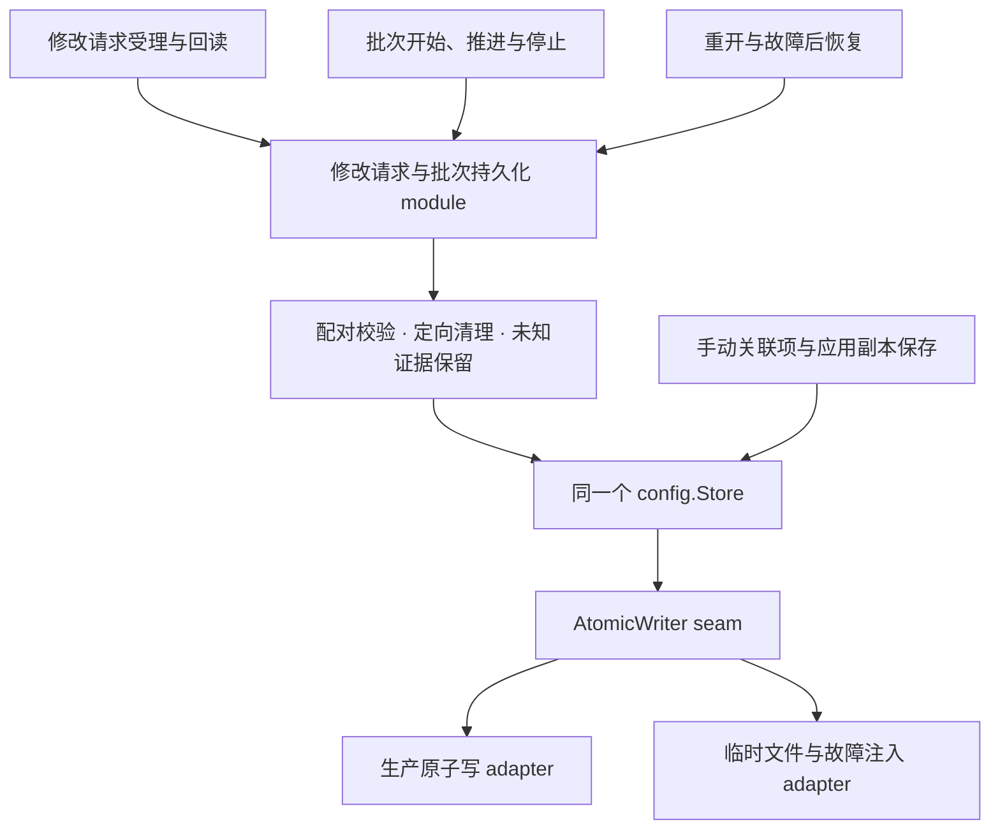

# 集中修改请求与批次的持久化规则

状态：2026-11-13，候选 03；完整设计已由用户确认，implementation、回归测试、Go 全量测试及相关 race 检查已完成。

基线为 `45b5e77`。本候选在 `change` 内形成一个持久化 module，集中修改请求与批次的配对、定向清理及故障后读取规则。此次核对复现了跨入口替换造成记录不一致的问题，因此收益已超出代码整理。

## 继承的决策

沿用 [GLOSSARY](../GLOSSARY.md)、[批量设置规格](batch-file-associations.md)及 [ADR-0002](adr/0002-explicit-batch-resume.md)，没有新增产品选择。

- 只保存最近一个已开始批次；重开只展示已保存事实，继续或重试必须重新预览并明确确认。
- 结果未定与成功、失败、取消不同；当前默认匹配目标不能证明旧修改请求完成。查询和读取记录不会重放系统修改。
- 调度系统修改前，未定请求与对应等待中的批次项必须在同一次更新中保存。完成并取得有效回读后，对应结果与未定记录的清除也必须合写。
- 保存失败暂停后续执行。原子写可能在替换文件后报错，错误不能证明文件未改变；恢复依据实际持久事实。
- 继续使用同一个 `config.Repository` / `config.Store` 更新完整配置，保留手动关联项和应用副本。兼容版本 1、2；首次保存批次才升级，浏览不迁移；损坏或未知版本保留原文件并阻止写入。
- Go 继续持有执行、互斥、系统完成、回读、停止、退出及重启安装。前端和原生调用 interface 保持现有行为。

## 当前摩擦与实证

| 路径 | 当前承担的持久化规则 |
| --- | --- |
| `service.go` 的 `ensureLoaded` 与 `batch.go` 的 `loadBatch` | 分别解码两段记录，再按请求身份配对；批次加载会先发布部分内存状态。 |
| `service.go` 的 `submit` | 构造等待中的批次项，将它与未定请求合写；单项分支只写未定请求。 |
| `service.go` 的 `clearPending` | 按请求身份清除未定记录，并写入已知批次结果。 |
| `batch.go` 的 `StartBatch`、`saveBatch` | 各自解码未定请求，判断是否已完成、是否已确认恢复，以及何时允许清理。 |
| `batch.go` 的 `advanceBatch`、`refreshBatchRecovery` | 保存报错后保留不确定性，重新读磁盘；是否读取却依赖批次的错误文案是否非空。 |

### 已复现：批次恢复后改做单项设置

1. 批次第一项已受理，磁盘保存 `Batch.item=waiting / 旧请求 ID` 和匹配的 `Pending`。
2. 重开后，内存将该项展示为 `unknown`；查询旧关联并明确确认后，用户可以提出单项修改。
3. 单项受理替换 `Pending`，但磁盘旧批次项仍是 `waiting / 旧请求 ID`。
4. 无论在新单项受理后还是完成后再重开，都会报“批次与未定请求记录不一致，已保留原文件”。

临时回归测试通过公开 `change.Service` interface、真实临时 Store 和可控 dispatcher 复现了两种重开时机。修复应在替换未定请求的同一次更新中，将旧批次项保留为结果未知，保留旧身份，避免悬空的等待关系；不能把它改成已完成或未执行。

### 已复现：停止后跳过同进程恢复检查

受理记录已落盘但 writer 报错后，批次暂停。随后成功停止批次会清除内存 `Batch.Error`；`PrepareBatch` 因此跳过恢复读取，下一次明确开始返回存储错误，要求重新打开后查询旧请求。

停止本身没有损坏记录：旧请求与未知批次项仍保留。缺口在于恢复入口依赖错误文案；应根据实际记录和当前活动状态决定恢复，不要求重开应用才能发现旧请求。

探索阶段的临时测试文件已删除，上述场景现已转为正式回归测试。这些修复落实既有配对与恢复规则，不扩大自动执行权限；对已经损坏的配置仍保留文件并报错。

## Module、interface 与 seam

新增 `internal/change/records.go`，使用包内具体类型持有现有 `config.Repository`。它没有另一份配置缓存、执行队列或新的公开 Go interface。

内部 interface 围绕五个实际动作组织。这里描述契约，具体包内命名在 implementation 中确定。

| 动作 | 调用方提供的事实 | Module 隐藏的 implementation |
| --- | --- | --- |
| 读取记录 | 无执行命令 | 一次读取完整配置，解码并校验两段记录及配对关系；全部有效后返回恢复展示所需的副本和请求归属。 |
| 保存受理 | 新修改请求、可选的所属批次、旧记录处理依据 | 构造对应等待项并合写；替换旧未定请求时，同时保存它在旧批次中的未知事实。单项也经过这条配对规则。 |
| 保存结算 | 已完成并取得有效回读的请求、当前批次副本 | 从已知结果生成对应批次项，按具体请求身份清理未定记录并合写；迟到结算不能清除另一请求。 |
| 保存开始或继续 | 已确认的新批次或继续方案、旧记录处理依据 | 清理已知完成的旧请求，或保留已明确确认的未知请求；保存最新批次及原提交身份。预览、替换确认和执行顺序仍由协调代码决定。 |
| 保存进度或停止 | 当前批次副本、已知完成的请求身份 | 保留未定证据；只有匹配的已知结果才能清理旧请求。停止和跳过项无需自行解码配置。 |

“旧记录处理依据”必须绑定具体请求 ID：已知完成的身份可以作为值传入；恢复确认还必须匹配本次命令与当前有效查询。不能用一个无身份的 `clearPending=true` 表示授权。

每次写入都在同一次 `Store.Update` 内检查原记录、应用修改并验证新配对。调用方不接触 `json.RawMessage` 或文档更新回调，也不分别保存 `Pending` 和 `Batch`。正常加载与故障后读取共用解码、校验和恢复投影；读取不把 `waiting → unknown` 的展示转换写回磁盘。

结算事实由现有系统完成与回读路径产生。持久化 module 只映射和保存这些事实，不根据当前默认推断旧请求成功。批次预览、尝试身份、执行顺序、准入、发布快照及是否推进下一项留在现有协调 implementation。

内部 seam 位于上述动作与配对持久化之间。文件写入继续使用已有 `AtomicWriter` seam，生产原子写和可控故障 writer 是两个实际 adapter；无需为此新增通用 repository 层。

## 故障与恢复契约

写入返回错误时，本次保存未获确认。Module 不根据返回错误猜测 rename 是否发生，不重试系统修改，不用补偿写覆盖可能已落盘的证据。批次暂停推进并展示存储错误；单项结算清理失败仍保留已知系统结果并释放 Busy，后续操作再处理残留记录。系统结果与存储错误分别呈现。

| 保存位置 | 文件替换前失败后重开 | 文件替换后报错后重开 | 当前进程行为 |
| --- | --- | --- | --- |
| 初始批次 | 原批次或没有批次 | 新批次清单，尚未受理项保留 | 不调度后续修改，报告保存失败。 |
| 修改请求受理 | 原有记录；该新尝试尚无等待记录 | 新请求与等待项配对，恢复为未知 | 不调用本次系统修改，暂停；下次操作检查实际记录。 |
| 完成结果与清理 | 旧等待记录恢复为未知 | 已保存结果，匹配的未定记录已清除 | 保留当前已知系统结果，暂停下一项。 |
| 停止后续设置 | 原批次记录 | 已保存停止进度 | 内存立即停止推进；任何重开都不自动执行。 |
| 恢复后单项替换 | 原未定请求与批次仍配对 | 新未定请求，旧批次项保留为未知 | 写入报错不调度；再次尝试依据实际记录重新进入恢复。 |

同进程重新准备预览或提出下一次修改时，在没有活动请求或受理占用的前提下检查持久记录。是否需要恢复不依赖 `Batch.Error`，停止或清除提示不能绕过检查。读取后在安装恢复状态前重查活动身份，避免旧读取覆盖已开始的新请求。已知提交身份优先通过原幂等路径返回；核对已完成请求不依赖新的磁盘读取。

已知完成的请求不因磁盘清理失败而在同一进程中重新变成未知；其明确结果可以在下一次合法保存时补写。进程重开后若只剩未定记录，则仍按未知恢复。损坏、配对冲突或读取失败保留原文件并阻止后续写入。

## 锁与事实归属

- `Service.mu` 继续保护运行时请求、恢复状态及快照；`batchMu` 继续串行化批次命令和推进；Store 的锁继续串行化整个配置的读写。新 module 不再增加一层锁。
- 已完成请求身份是单调事实，可在 `mu` 下复制后用于本次保存。不要把全部运行时历史或可变状态交给 records 长期持有。
- `Recovery.Ready` 会被并发关联查询改变，不能在 module 中缓存为长期授权。对于实际磁盘中的旧请求，在 `Update` 内调用仅属于本次命令的恢复身份校验，保留现有开始保存时的动态校验。该校验只短暂读取 `mu` 下的事实，不访问 Store、不获取 `batchMu`。
- 不持有 `Service.mu` 等待磁盘 I/O；保持已有 `batchMu → Store → 短暂 mu 校验` 的方向，禁止反向调用。退出确认不能被阻塞的 writer 卡住。
- 保存成功后才接纳相应持久结果；保存失败时由协调代码保留当前已知事实并暂停批次推进。读取恢复副本不能覆盖仍在处理的请求或使已确认结果倒退。

## 改动安排与验证

1. 新增 `records.go`，集中成对解码、校验、恢复投影、受理、结算及批次保存规则。
2. `service.go` 接入统一加载、受理与结算；`batch.go` 移除重复配置解码和清理，故障恢复使用同一读取路径，取消错误文案门控。保留单项与批次的现有对外 interface。
3. 将已复现的两条路径变为正式集成回归测试；批次恢复后单项替换同时覆盖新请求受理中与完成后重开、替换前失败及落盘后报错。
4. 保留现有受理合写、结果保存失败、同进程恢复、显式继续、晚到回调、退出和重启测试。只为缺少的记录契约补充 module interface 测试，不重复铺设一套相同场景。
5. 验证未知版本、损坏及配对错误不会被覆盖，手动关联项和应用副本与请求更新并行时不丢失。增加阻塞 writer 与并发恢复查询的针对性检查，避免锁顺序或确认时机退化。
6. 实施后运行 `go test ./internal/change ./internal/config`、相关 race 检查与 Go 全量测试。变更仅涉及 Go 持久化，不需要重复前端浏览器验收；真实 macOS 系统修改不由替身测试代替。

设计阶段的既有测试通过；使用 `-count=1` 的临时回归曾复现跨入口替换的两个重开失败与停止后的恢复入口缺口。正式实现后，这些回归均已通过。

## 实施验证

- [`records.go`](../internal/change/records.go) 提供 `load`、`admit`、`settle`、`startBatch`、`saveProgress` 五个包内动作，统一检查更新前后的配对。`service.go`、`batch.go`、`recovery.go` 不再分别解码或修改配置字段；共享快照的 JSON 克隆不属于持久化规则，继续保留。
- [`records_integration_test.go`](../internal/change/records_integration_test.go) 覆盖批次恢复后单项替换的受理中与完成后重开、替换前失败及落盘后报错、停止后同进程恢复、存储等待期间恢复查询失效，以及后续磁盘故障不阻断已知提交的幂等核对。
- [`records_test.go`](../internal/change/records_test.go) 通过内部 interface 验证损坏或不配对的记录阻止所有写入、清理依据必须匹配身份、迟到结算不能覆盖新请求、读取不落盘或迁移，以及首次批次保存保留手动数据并升级版本。
- `go test ./internal/change ./internal/config`、`go test -race ./internal/change ./internal/config` 与 `go test ./...` 均通过；现有受理、回读、显式继续、退出及重启测试保留。
- 全量测试的链接器仍报告重复 `-lobjc` 和 macOS 目标版本差异，未影响测试通过。本次未修改原生构建配置。

故障和恢复验收使用临时配置与可控 dispatcher；本轮没有进行手工真实系统修改验收，也没有改动前端。

## Depth 与验收标准

locality：修改配对、清理或恢复投影时，只需在同一个 implementation 修改并验证；受理、回读、批次保存和重开不再各自解释磁盘记录。

leverage：同一组规则覆盖单项、批量和恢复后的跨入口操作。测试通过调用方使用的 interface 检查真实落盘结果与系统调用次数。

deletion test：删去此 module 后，旧请求如何被新请求替换、哪些结果允许定向清理、等待项如何恢复为未知、写失败后如何保留证据等规则应重新散回多条路径。若只是移动 Marshal/Unmarshal，或调用方仍需手工维护两段记录的配对，则没有增加 depth，不符合本方案。
